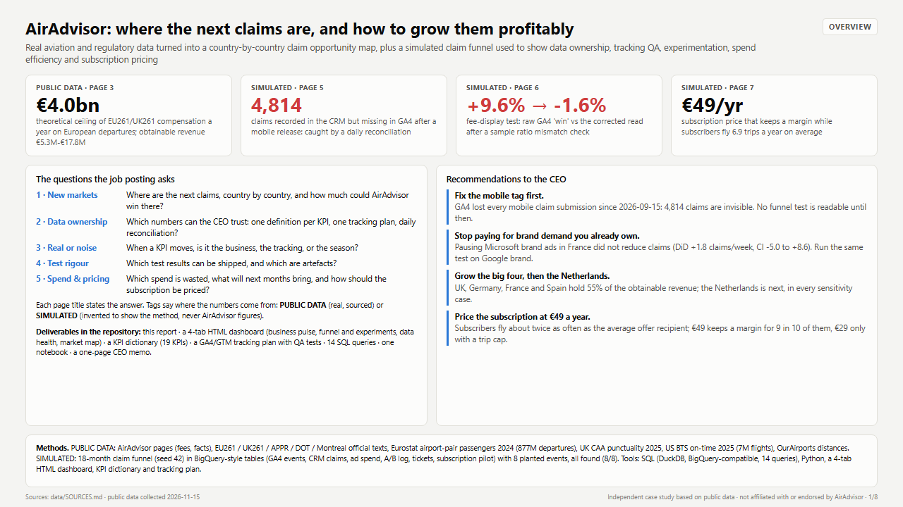
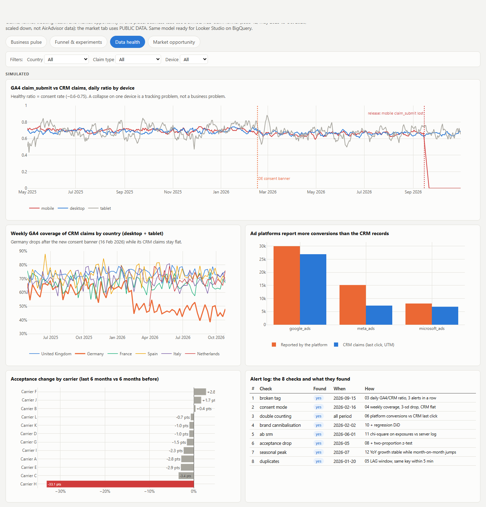

# AirAdvisor: where the next claims are, and how to grow them profitably

Real aviation and regulatory data turned into a country-by-country claim opportunity map, plus a simulated claim funnel used to show data ownership, tracking QA, experimentation, spend efficiency and subscription pricing.

**[Read the report (PDF, 8 pages)](docs/AirAdvisor_ClaimsGrowth_CaseStudy.pdf)** · **[Dashboard](dashboard/insights_cockpit.html)** (one self-contained HTML file: download it and open it in a browser) · [CEO memo](docs/CEO_MEMO_example.md) · [KPI dictionary](docs/KPI_DICTIONARY.md) · [Tracking plan](docs/TRACKING_PLAN.md) · [Notebook](notebooks/airadvisor_analysis.ipynb)

> Independent case study based on public data · not affiliated with or endorsed by AirAdvisor.
> **PUBLIC DATA** = real, sourced data. **SIMULATED** = invented data that shows the method; it is never AirAdvisor's data.



## Key results
1. **Where the next claims are (PUBLIC DATA).** 877M passengers departed from 31 European countries (EU/EEA/CH + UK), and 1.37% of them were on flights 3h+ late or cancelled. If every disruption were the airline's fault and every passenger claimed, that would be a **theoretical ceiling of about €4.0bn a year** in EU261/UK261 compensation. After eligibility, claim rates, agency share and an obtainable share, the UK, Germany, France and Spain hold 55% of the obtainable revenue. The **Netherlands is the next market**, and that ranking holds under every sensitivity test.
2. **Tracking is the first suspect (SIMULATED).** A daily GA4 vs CRM reconciliation catches a broken mobile `claim_submit` tag on day one: 4,814 claims are in the CRM but not in GA4. The same check separates a German consent-banner effect (GA4 coverage 63% → 47%, CRM flat) from a summer peak that is only the season.
3. **Tests are read on what was randomised (SIMULATED).** A fee-display test "wins" by +9.6% in GA4, but a sample ratio mismatch (p < 0.001) shows that variant B lost low-intent mobile users before they were logged. Read on the server assignments with CRM outcomes, the effect is -1.6% (not significant). A difference-in-differences on a Microsoft brand-ads pause in France finds no loss of claims: SEO picked them up.
4. **Subscription pricing (PUBLIC + SIMULATED).** With real disruption probabilities (0.75% eligible per flight, €335 average), subscribers cost €20-26 a year. A three-tier pilot shows that subscribers fly about twice as often as the average person offered the plan. **€49 a year** keeps a margin for 9 in 10 subscribers; €29 only works with a trip cap.

All 8 problems planted in the simulation are found by the checks (scored at the end against a hidden answer key).



## What is in the repository
| Path | Content |
|---|---|
| `docs/AirAdvisor_ClaimsGrowth_CaseStudy.pdf` | 8-page report; page images in `docs/img/` |
| `dashboard/insights_cockpit.html` | 4 tabs (Business pulse, Funnel & experiments, Data health, Market opportunity) with country, claim-type and device filters. The same model is ready for Looker Studio on BigQuery: each chart reads one pre-aggregated view |
| `docs/KPI_DICTIONARY.md` | 19 KPIs: definition, SQL, source of truth, owner, pitfalls |
| `docs/TRACKING_PLAN.md` | GA4/GTM events, data layer, Consent Mode v2 behaviour, QA test per event, server-side and offline conversions |
| `docs/CEO_MEMO_example.md` | One-page memo: recommendation first, three proofs, risks, next step |
| `sql/` | 14 queries (DuckDB, BigQuery-compatible, a "BigQuery note" where the syntax differs): funnel, segments, QA checks, deduplication, attribution, unit economics, cohorts/LTV, difference-in-differences, SRM, seasonality, KPI scorecard, subscription pilot |
| `notebooks/airadvisor_analysis.ipynb` | The single notebook that walks through every result |
| `src/` | `download_data.py`, `build_public.py` (country model), `simulate.py`, `analysis.py`, `build_dashboard.py`, `build_pdf.py`, `run_sql.py`, `collect_trends.py` (optional) |
| `data/public/` | Small derived public tables (market model, disruption rates, seasonality, US benchmark) |
| `data/processed/` | Aggregates kept from large files (BTS 2025 by carrier x route x month; routes with distances) |
| `data/simulated/` | BigQuery-style simulated tables (Parquet): `events`, `claims`, `ad_spend`, `experiment_assignments`, `support_tickets`, `subscriptions_test` |
| `data/_hidden_truth.csv` | Answer key of the 8 planted events. It is read only by the final scoring step of `src/analysis.py`; it stays in the repository so that the scoring can be checked |
| `data/SOURCES.md`, `data/ASSUMPTIONS.md` | Every source with link, date and licence; every assumption with its range |

## Methods
- **Market model (PUBLIC DATA):** Eurostat airport-pair passengers (2024) and UK CAA route passengers (2025), x the share of flights 181+ min late or cancelled (UK CAA 2025, routes between the UK and each country, shrunk toward the mean for small samples), x the EU261/UK261 amount for the route distance (OurAirports coordinates; GBP converted at the ECB 2025 average). The result is narrowed to TAM, SAM and SOM with stated assumptions, then stress-tested: one-at-a-time sensitivity on every assumption, and rank stability under four other ways of measuring disruption. US BTS 2025 (7M flights) calibrates the share of 3-4 h delays and the carrier-caused share of long delays.
- **Simulation (SIMULATED):** 18 months, 6 markets (the Netherlands opens in month 12), 4 claim types, 3 devices, 6 sources; seed 42. It is calibrated on real route distances, the CAA monthly seasonality and AirAdvisor's published fees. Eight problems are planted: a broken tag, a consent banner, platform double counting, brand cannibalisation, an A/B sample ratio mismatch, an acceptance drop, a seasonal false signal and duplicates.
- **Statistics:** chi-square SRM test, two-proportion z-tests with confidence intervals, power and minimum detectable effect, difference-in-differences regression with country and week fixed effects (HC1 errors) and a placebo test, log-linear seasonal forecast, cohort LTV, unit economics per paid claim.
- **Tooling:** SQL on DuckDB, written to port to BigQuery. Python with Polars, NumPy, SciPy, matplotlib and Plotly. The PDF is HTML printed by headless Edge.

## How to reproduce
```bash
python -m venv .venv
.venv\Scripts\pip install -r requirements.txt        # macOS/Linux: .venv/bin/pip
python src/download_data.py          # public data into data/raw (BTS ~330 MB, kept only as an aggregate); --skip-bts to skip it
python src/build_public.py           # country opportunity model -> data/public
python src/simulate.py               # simulated tables -> data/simulated (seed 42)
python src/analysis.py               # every result -> data/output
python src/run_sql.py                # optional: print the 14 SQL queries' results
jupyter nbconvert --to notebook --execute --inplace notebooks/airadvisor_analysis.ipynb
python src/build_dashboard.py        # dashboard/insights_cockpit.html
python src/build_pdf.py              # docs/AirAdvisor_ClaimsGrowth_CaseStudy.pdf (needs Edge or Chrome)
```

## Sources and licences
AirAdvisor's own website (home and pricing page) and job posting, read by hand on 15 Nov 2026; its figures are given as stated by AirAdvisor, and no reviews were collected. Official rules: Regulation (EC) 261/2004 (EUR-Lex, Your Europe), UK CAA, the Canadian Transportation Agency (APPR and Montreal Convention limits), US DOT, IMF SDR rates. Data: Eurostat `avia_par`/`avia_paoc` (free re-use with attribution), UK CAA punctuality and airport statistics (Open Government Licence v3), US BTS On-Time Performance (public domain), OurAirports (public domain), ECB exchange rates. Competitors: published fee pages only (AirHelp, Flightright). Full details are in [data/SOURCES.md](data/SOURCES.md).

## Limits
- Country disruption rates use UK-to-country routes as a proxy, and the CAA measures punctuality at UK airports. Claim rate, agency share, obtainable share and airline-control share are assumptions with ranges, not statistics: the ranking is robust, but the euro amounts are a range (about €5M to €18M SOM).
- The ceiling is a maximum. A delayed flight does not always owe compensation: extraordinary circumstances (weather, air traffic control, security) remove the right to it. Nothing here says anything about any real airline's conduct, and nothing here is legal advice.
- Simulated levels (conversion, CAC, acceptance) are plausible, not AirAdvisor's. The subscription pilot is 2-5 months old, so renewal is a projection. The brand pause covers one country for 8 weeks.
- Google Trends was not used: the optional script needs pandas, which the local security software blocked on the build machine. Seasonality comes from the CAA monthly files instead.

## Methods: AI note
AI-assisted workflow: I used Claude, mainly to write scripts faster. I drove the project: I defined the questions, chose and validated the data sources, made the analytical decisions and checked every result.
